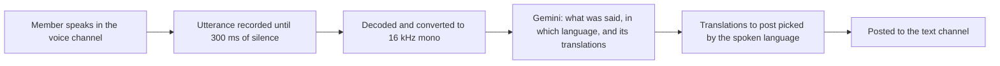

# Discord AI-Powered Multilingual Translation Bot 🌍

<div align="center">

**Break language barriers in real time with AI-powered voice translation**

A Discord bot that listens in a voice channel and posts what is said there, transcribed and translated by Google Gemini, to a text channel. Translate everything into one language, or between a pair of languages, such as Japanese ⇄ Korean, both ways.

[](LICENSE)
[](https://nodejs.org/)
[](https://www.typescriptlang.org/)
[](https://discord.js.org/)

</div>

> This project is based on [lifegence/wp-plugin-lifegence-aitranslator-discord-bot](https://github.com/lifegence/wp-plugin-lifegence-aitranslator-discord-bot) by Lifegence Corporation, used under the MIT License. It is maintained independently and is not affiliated with Lifegence Corporation.

## ✨ Features

- 🎙️ **Voice translation**: Each utterance in the voice channel is transcribed and translated in one Gemini request, once the speaker pauses for 300 ms
- 🔁 **Language pairs**: Translate between two languages both ways: what is said in one is translated into the other, and anything else into both
- 🔍 **Automatic language detection**: Gemini tells which language was spoken, so nobody has to set the language they speak
- 💬 **What was said, and its translation**: Each post shows what was said under the speaker's name, with its translations quoted below
- 📣 **Open about where speech goes**: When translation starts, everyone in the text channel is told that what is said is sent to Google Gemini
- 🧪 **Try it without an API key**: `TRANSLATOR=fake` posts placeholders instead of translations and sends nothing anywhere
- 📊 **Status at a glance**: `/translate-status` shows the languages, how long translation has run, and how many are speaking

## 🌍 Supported Languages

The slash commands offer these 10 languages:

| Language | Native Name | Code |
|----------|-------------|------|
| Japanese | 日本語 | `ja` |
| English | English | `en` |
| Korean | 한국어 | `ko` |
| Chinese | 中文 | `zh` |
| Spanish | Español | `es` |
| French | Français | `fr` |
| German | Deutsch | `de` |
| Italian | Italiano | `it` |
| Portuguese | Português | `pt` |
| Russian | Русский | `ru` |

`DEFAULT_TARGET_LANGUAGE` also takes any other well-formed [BCP 47](https://www.rfc-editor.org/info/bcp47) language tag, such as `zh-TW` or `vi`. The tag is passed to Gemini as it is, so how well another language works depends on Gemini. Tags are checked and put in canonical form with `Intl.getCanonicalLocales` (ECMA-402): `ZH-tw` becomes `zh-TW`, and a malformed tag such as `ja_JP` stops the bot at startup.

## 🎯 Use Cases

- 🎮 **International Gaming Communities**: Play with friends worldwide without language barriers
- 💼 **Remote Teams**: Multilingual team meetings and collaboration
- 🎓 **Educational Settings**: Language learning and international classrooms
- 👥 **Community Events**: Host inclusive events for diverse communities
- 🤝 **Cultural Exchange**: Japanese and Korean speakers, say, talking in one voice channel, each reading the other in their own language

## 📋 Prerequisites

- Node.js 22.12 or later, which `@discordjs/voice` requires. CI runs on Node 22, 24 and 26.
- pnpm 12. The exact version is pinned in `package.json` (`packageManager`).
- A Discord application with a bot
- A Google Gemini API key, unless you try the bot with `TRANSLATOR=fake`

## Installation

1. Clone the repository:
```bash
git clone https://github.com/Fkinds/discord-aitranslate-bot.git
cd discord-aitranslate-bot
```

2. Install pnpm 12 if you do not have it, then the dependencies:
```bash
npm install -g pnpm@12
pnpm install
```
`@discordjs/opus`, the native Opus decoder, downloads a prebuilt binary or compiles one; it is the only dependency allowed to run an install script (`pnpm-workspace.yaml`). `pnpm install` also installs the Git hooks (see [Development](#development)).

3. Copy `.env.example` to `.env`:
```bash
cp .env.example .env
```

4. Edit `.env` with your keys (see [Configuration](#configuration) for every setting):
```env
DISCORD_BOT_TOKEN=your_discord_bot_token_here
DISCORD_CLIENT_ID=your_discord_client_id_here
GOOGLE_GEMINI_API_KEY=your_gemini_api_key_here
DEFAULT_TARGET_LANGUAGE=ja
```

## Getting the Keys

### Discord Bot Token

1. Go to the [Discord Developer Portal](https://discord.com/developers/applications)
2. Create a new application. Its Application ID is `DISCORD_CLIENT_ID`.
3. In the "Bot" section, reset and copy the token: `DISCORD_BOT_TOKEN`

The bot needs no privileged gateway intents. It uses only Guilds, Guild Voice States and Guild Messages.

### Invite URL

Invite the bot with this URL, replacing `CLIENT_ID`:
```
https://discord.com/oauth2/authorize?client_id=CLIENT_ID&permissions=1051648&scope=bot+applications.commands
```

The permissions are only those the bot uses:
- View Channels
- Send Messages, to post translations
- Connect, to join the voice channel

The bot never plays audio, so it does not need Speak.

### Google Gemini API Key

1. Go to [Google AI Studio](https://aistudio.google.com/apikey)
2. Sign in with your Google account
3. Create an API key: `GOOGLE_GEMINI_API_KEY`

> **Free tier and privacy**: On the free tier of the Gemini API, what the bot sends, the voices in the voice channel, is used to improve Google's products, and people may read it. On the paid tier it is not. Apps offered to people in the EEA, the UK or Switzerland must use the paid tier. See the [pricing](https://aistudio.google.com/docs/pricing) and the [terms](https://aistudio.google.com/docs/terms).

## Usage

### Build the Project

```bash
pnpm run build
```

### Register the Slash Commands

Before first use, and again whenever an update changes the commands:
```bash
pnpm deploy-commands
```

### Start the Bot

**In the background, with the scripts:**

Start the bot:
```bash
./start-bot.sh
```

Stop the bot:
```bash
./stop-bot.sh
```

View the logs:
```bash
tail -f bot.log
```

**In the foreground:**

```bash
pnpm start
```

To run from the TypeScript sources, without building:
```bash
pnpm dev
```

### Discord Commands

The bot answers each command so that only you see the answer.

#### `/translate-join [language] [second-language]`
Join your voice channel and start translating what is said there into the channel you ran the command in.
- `language` (optional): the language to translate into, or the first of a pair
- `second-language` (optional): the other language of a pair: what is said in either language is translated into the other

With neither, the bot uses `DEFAULT_TARGET_LANGUAGE`. With only `second-language`, it pairs it with the first language of `DEFAULT_TARGET_LANGUAGE`.

When translation starts, the bot tells everyone in the text channel that what is said in the voice channel is sent to Google Gemini (with `TRANSLATOR=fake`, that it is sent nowhere).

Examples:
```
/translate-join language:English
/translate-join language:Japanese (日本語) second-language:Korean (한국어)
```

#### `/translate-leave`
Leave the voice channel and stop translating.

#### `/translate-language <language> [second-language]`
Change the languages: one language, or a pair, as for `/translate-join`. One language chosen twice is refused.

Example:
```
/translate-language language:Korean (한국어)
```

#### `/translate-status`
Show the languages, how long translation has run, how many are speaking, and the channels.

### What Gets Posted

Each utterance is posted with what was said under the speaker's name, and each translation quoted below it:

```
**Alice**: 안녕하세요
> こんにちは
```

Which translations are posted depends on the language that was spoken:

| Languages | Spoken in | Posted |
|-----------|-----------|--------|
| Japanese ⇄ Korean | Korean | What was said, and its Japanese translation |
| Japanese ⇄ Korean | Japanese | What was said, and its Korean translation |
| Japanese ⇄ Korean | English | What was said, and both translations |
| Japanese | English | What was said, and its Japanese translation |
| Japanese | Japanese | Only what was said |

Nothing is posted when no words were heard. Mentions in a post, such as `@everyone`, show as text and notify nobody.

## Configuration

All configuration is done through environment variables, read from `.env`:

| Variable | Description | Default |
|----------|-------------|---------|
| `DISCORD_BOT_TOKEN` | Discord bot token | Required |
| `DISCORD_CLIENT_ID` | Discord application ID | Required |
| `GOOGLE_GEMINI_API_KEY` | Gemini API key | Required, unless `TRANSLATOR=fake` |
| `TRANSLATOR` | `gemini`, or `fake` to post placeholders and send nothing anywhere | `gemini` |
| `GEMINI_MODEL` | Gemini model to use; it must take audio | `gemini-3.8-flash` |
| `DEFAULT_TARGET_LANGUAGE` | A language tag, or two separated by a comma for a pair, such as `ja,ko` | `ja` |
| `LOG_LEVEL` | `error`, `warn`, `info` or `debug` | `info` |

An empty variable counts as unset. A missing or malformed setting stops the bot at startup, with a message that says which.

## 🎬 How It Works



1. 🎤 **Join**: A member runs `/translate-join`, and the bot joins their voice channel.
2. 🎙️ **Listen**: Discord tells the bot who is speaking. The bot records each member's utterance until they have been silent for 300 ms.
3. 🎵 **Convert**: The Opus audio is decoded and converted to 16 kHz mono, then wrapped in a WAVE file.
4. 🤖 **Translate**: Gemini gets the audio with its instructions and a JSON Schema for its answer (structured output). It answers with what was said, which of the session's languages was spoken (or another), and a translation into each of the session's languages.
5. 💬 **Post**: The bot posts what was said and the translations the spoken language calls for (see [What Gets Posted](#what-gets-posted)).

### When Gemini Fails

- Each request may take 15 seconds.
- A failure that may pass is tried again, up to 3 attempts in all, 1 second and then 2 seconds apart: HTTP 408, 429, 500, 502, 503 or 504, a failed connection, or a timeout.
- A 429 that asks for a wait of up to 5 seconds is tried again after that wait; one that asks for longer is given up on.
- Any other failure, an answer Gemini blocked, or an answer in another form than asked for, is given up on at once.
- Nothing is posted for an utterance that could not be translated; the failure is logged.

## Troubleshooting

### Commands do not appear or do not respond
- Register them: `pnpm deploy-commands`, again after an update that changes them
- Check that the bot was invited with the `applications.commands` scope
- Check `DISCORD_BOT_TOKEN` in `.env`

### `pnpm install` fails on `@discordjs/opus`
- It downloads a prebuilt binary for your platform and Node.js version, and compiles one with node-gyp when there is none. Compiling needs Python and a C++ compiler.
- Use Node.js 22, 24 or 26, the versions CI checks.

### Nothing is translated
- Check that the bot can connect to the voice channel and post in the text channel
- Look for `User started speaking` in the log: it shows that the bot hears speech. `LOG_LEVEL=debug` logs more, such as the states of the voice connection
- Check `GOOGLE_GEMINI_API_KEY`, and that `GEMINI_MODEL` names a model that takes audio
- HTTP 429 errors mean a rate limit; the free tier's limits are on [AI Studio](https://aistudio.google.com/rate-limit)
- To check everything but Gemini, run with `TRANSLATOR=fake`

## Development

### Scripts

| Command | What it does |
|---------|--------------|
| `pnpm run build` | Compile the TypeScript in `src/` into `dist/` |
| `pnpm test` | Run the small tests (the same as `pnpm test:small`) |
| `pnpm test:medium` | Run the medium tests |
| `pnpm test:watch` | Run the small tests again on every change |
| `pnpm test:coverage` | Run the small and medium tests with a coverage report |
| `pnpm lint:layers` | Check the dependencies between the layers |

### Tests by Size

Tests are sorted by what they depend on, not by how long they take:

| Size | May use | Where | Run |
|------|---------|-------|-----|
| Small | The process only: no network, not even localhost | `tests/small/` | Before every commit, and in CI |
| Medium | Servers on localhost, such as stand-ins for the Gemini and Discord APIs | `tests/medium/` | In CI, after the small tests pass |

The test environment holds tests to this: a small test that opens a connection, or a medium test that connects to anything but localhost, fails. A test file outside these directories stops the run. CI runs on Node.js 22, 24 and 26, and its `ci` check must pass before a pull request can be merged.

### Git Hooks

`pnpm install` installs Git hooks with [prek](https://github.com/j178/prek) (`prek.toml`). Before each commit they check:
- that the commit message follows [Conventional Commits 1.0.0](https://www.conventionalcommits.org/en/v1.0.0/)
- the dependencies between the layers, when `src/` changed
- the small tests

### Project Structure

```
src/
├── domain/              # Sessions, languages and Discord IDs: the rules, depending on nothing
├── usecases/            # Start, stop, change the languages, show the status, translate an utterance
│   └── ports/           # What the use cases need from outside: translator, voice, publisher, logger
├── infrastructure/      # The ports' implementations, the settings and the logger
│   ├── discord/         # Joining voice channels, receiving speech, posting
│   └── gemini/          # Translating with Gemini
├── interfaces/          # Slash commands and voice events in, use cases, Discord answers out
│   └── discord/
├── main.ts              # Builds the bot and wires it to Discord
└── deploy-commands.ts   # Registers the slash commands

tests/
├── small/               # Laid out like src/
├── medium/
└── support/             # Fakes, builders and the test environment
```

### Architecture

The code follows Clean Architecture. [dependency-cruiser](https://github.com/sverweij/dependency-cruiser) checks the layers in CI and before every commit (`.dependency-cruiser.cjs`):

| Layer | May depend on |
|-------|---------------|
| `domain` | Nothing |
| `usecases` | `domain` |
| `infrastructure` | `domain`, `usecases`, packages and Node.js |
| `interfaces` | `domain`, `usecases`, packages and Node.js |
| `main.ts`, `deploy-commands.ts` | Everything; nothing depends on them |

- The use cases give their outcomes as values, such as `started` or `alreadyRunning`; exceptions are for technical failures.
- The translator, the voice connection and the publisher are ports, so the tests run the use cases with fakes.

## Contributing

Contributions are welcome! Please follow these steps:

1. Fork the repository
2. Create a feature branch
3. Write tests with your change, in the directory of their size
4. Make sure `pnpm test`, `pnpm test:medium` and `pnpm lint:layers` pass
5. Write commit messages that follow Conventional Commits
6. Submit a pull request

## License

MIT License - see LICENSE file for details

## Acknowledgments

- Built with [discord.js](https://discord.js.org/) and [@discordjs/voice](https://github.com/discordjs/discord.js/tree/main/packages/voice)
- Translation powered by the [Google Gemini API](https://ai.google.dev/), through [@google/genai](https://github.com/googleapis/js-genai)
- Opus decoding with [@discordjs/opus](https://github.com/discordjs/opus)

## Support

For issues and questions:
- Open an issue on GitHub
- Check existing issues for solutions
- Review logs with `LOG_LEVEL=debug`
