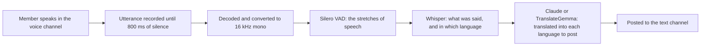

# Discord AI-Powered Multilingual Translation Bot 🌍

<div align="center">

**Break language barriers in real time with AI-powered voice translation**

A Discord bot that listens in a voice channel and posts what is said there, transcribed and translated, to a text channel. By default it transcribes on the machine it runs on, with Whisper, and has Claude Haiku 5.5 translate the text, for a few cents a month. It can translate for free on your own machine instead, with Google's TranslateGemma on Ollama, or use Google Gemini. Translate everything into one language, or between a pair of languages, such as Japanese ⇄ Korean, both ways.

[](LICENSE)
[](https://nodejs.org/)
[](https://www.typescriptlang.org/)
[](https://discord.js.org/)

</div>

> This project is based on [lifegence/wp-plugin-lifegence-aitranslator-discord-bot](https://github.com/lifegence/wp-plugin-lifegence-aitranslator-discord-bot) by Lifegence Corporation, used under the MIT License. It is maintained independently and is not affiliated with Lifegence Corporation.

## ✨ Features

- 🎙️ **Voice translation**: Each utterance in the voice channel is transcribed and translated once the speaker pauses for 800 ms
- 👂 **Hears on your own machine**: By default, Whisper transcribes on the machine the bot runs on, so the voices go nowhere else
- 🌐 **Translated by Claude**: Claude Haiku 5.5 translates the text into every language to post in one request, keeping names and the speaker's tone
- 🆓 **Or for free, on your machine**: `TRANSLATOR=translategemma` has Google's TranslateGemma translate the text on [Ollama](https://ollama.com/), so nothing is paid, and with Ollama on the same machine, nothing leaves it
- ☁️ **Or with Gemini**: `TRANSLATOR=gemini` sends each utterance to Google Gemini instead, which takes any language
- 🔁 **Language pairs**: Translate between two languages both ways: what is said in one is translated into the other. With Gemini, anything else is translated into both
- 🔍 **Automatic language detection**: The bot tells which language was spoken, so nobody has to set the language they speak
- 💬 **What was said, and its translation**: Each post shows what was said under the speaker's name, with its translations quoted below
- 📣 **Open about where speech goes**: When translation starts, everyone in the text channel is told where what is said goes
- 🧪 **Try it without the models or a key**: `TRANSLATOR=fake` posts placeholders instead of translations and sends nothing anywhere
- 📊 **Status at a glance**: `/translate-status` shows the languages, how long translation has run, and how many are speaking

## 🌍 Supported Languages

The slash commands offer these 10 languages:

| Language | Native Name | Code |
|----------|-------------|------|
| Japanese | 日本語 | `ja` |
| English | English | `en` |
| Korean | 한국어 | `ko` |
| Chinese | 中文 | `zh` |
| Spanish | Español | `es` |
| French | Français | `fr` |
| German | Deutsch | `de` |
| Italian | Italiano | `it` |
| Portuguese | Português | `pt` |
| Russian | Русский | `ru` |

With Claude (the default) or TranslateGemma, the bot translates into these 10 only, which Whisper tells apart by their tags. TranslateGemma also translates only from these 10: nothing is posted for what was said in another language. With `TRANSLATOR=gemini`, `DEFAULT_TARGET_LANGUAGE` also takes any other well-formed [BCP 47](https://www.rfc-editor.org/info/bcp47) language tag, such as `zh-TW` or `vi`. The tag is passed to Gemini as it is, so how well another language works depends on Gemini. Tags are checked and put in canonical form with `Intl.getCanonicalLocales` (ECMA-402): `ZH-tw` becomes `zh-TW`, and a malformed tag such as `ja_JP` stops the bot at startup.

## 🎯 Use Cases

- 🎮 **International Gaming Communities**: Play with friends worldwide without language barriers
- 💼 **Remote Teams**: Multilingual team meetings and collaboration
- 🎓 **Educational Settings**: Language learning and international classrooms
- 👥 **Community Events**: Host inclusive events for diverse communities
- 🤝 **Cultural Exchange**: Japanese and Korean speakers, say, talking in one voice channel, each reading the other in their own language

## 📋 Prerequisites

- Node.js 22.12 or later, which `@discordjs/voice` requires. CI runs on Node 22, 24 and 26.
- pnpm 12. The exact version is pinned in `package.json` (`packageManager`).
- A Discord application with a bot
- For Claude (the default):
  - An Anthropic account with API credits, to sign in to with `ant auth login`, or an Anthropic API key
  - 1.0 GB of disk for the speech models, and about 3.5 GB of free memory while the bot runs (measured on a Mac). Whisper runs on the CPU. It is tried on macOS with Apple silicon, and in CI on Linux x64.
- For TranslateGemma (`TRANSLATOR=translategemma`):
  - The speech models, as for Claude
  - [Ollama](https://ollama.com/download), on the same machine or another
  - 8.1 GB of disk for the 12B model, and about 8 GB of free memory for it, on top of Whisper's (7.8 GB, measured on a Mac with Apple silicon). The 4B model takes 3.3 GB, and translates less well.
- A Google Gemini API key, only with `TRANSLATOR=gemini`

## Installation

1. Clone the repository:
```bash
git clone https://github.com/Fkinds/discord-aitranslate-bot.git
cd discord-aitranslate-bot
```

2. Install pnpm 12 if you do not have it, then the dependencies:
```bash
npm install -g pnpm@12
pnpm install
```
`@discordjs/opus`, the native Opus decoder, downloads a prebuilt binary or compiles one; it is the only dependency allowed to run an install script (`pnpm-workspace.yaml`). `pnpm install` also installs the Git hooks (see [Development](#development)).

3. Copy `.env.example` to `.env`:
```bash
cp .env.example .env
```

4. Edit `.env` with your keys (see [Configuration](#configuration) for every setting):
```env
DISCORD_BOT_TOKEN=your_discord_bot_token_here
DISCORD_CLIENT_ID=your_discord_client_id_here
DEFAULT_TARGET_LANGUAGE=ja
```
For Claude, sign in to Anthropic, or add an API key: see [Anthropic: Sign In, or an API Key](#anthropic-sign-in-or-an-api-key).

5. Download the speech models (1.0 GB), once:
```bash
pnpm models:download
```
It downloads each model from where its makers publish it, at a fixed version, and checks its SHA-256. Running it again keeps the files that are there and intact, and downloads the rest. With `TRANSLATOR=translategemma`, it then has Ollama pull the TranslateGemma model (see [TranslateGemma on Ollama](#translategemma-on-ollama-no-key)). To translate with Gemini instead, skip this and set `TRANSLATOR=gemini` and `GOOGLE_GEMINI_API_KEY`.

## Getting the Keys

### Discord Bot Token

1. Go to the [Discord Developer Portal](https://discord.com/developers/applications)
2. Create a new application. Its Application ID is `DISCORD_CLIENT_ID`.
3. In the "Bot" section, reset and copy the token: `DISCORD_BOT_TOKEN`

The bot needs no privileged gateway intents. It uses only Guilds, Guild Voice States and Guild Messages.

### Invite URL

Invite the bot with this URL, replacing `CLIENT_ID`:
```
https://discord.com/oauth2/authorize?client_id=CLIENT_ID&permissions=1051648&scope=bot+applications.commands
```

The permissions are only those the bot uses:
- View Channels
- Send Messages, to post translations
- Connect, to join the voice channel

The bot never plays audio, so it does not need Speak.

### Anthropic: Sign In, or an API Key

For Claude, the default translator. The bot calls Claude with `ANTHROPIC_API_KEY` when it is set, and otherwise with what the Anthropic SDK finds: a sign-in, or Workload Identity Federation.

**Sign in, with no API key**, on the machine the bot runs on:
1. Install the Anthropic CLI: `brew install anthropics/tap/ant` on macOS; for other systems, see the [CLI quickstart](https://platform.claude.com/docs/en/cli-sdks-libraries/cli/quickstart)
2. Run `ant auth login`, and approve in the browser tab it opens. Pick the organization and the workspace the bot should use.
3. `ant auth status` shows who is signed in.

The sign-in keeps its tokens in `~/.config/anthropic/`, readable only by you, and the SDK renews them. It runs out some weeks after you sign in, however much it is used; sign in again then. Signing in is meant for your own machine.

**Or an API key**: create one on the [API keys](https://platform.claude.com/settings/keys) page of the Claude Console, and set `ANTHROPIC_API_KEY`. You can give it an expiry as you create it. While the key is set, the bot uses the key, not the sign-in.

**On a server, in CI or in a container**: use [Workload Identity Federation](https://platform.claude.com/docs/en/manage-claude/workload-identity-federation). The identity tokens (OIDC) the platform gives the bot are exchanged for tokens that last minutes, so no key is kept there. Set the variables it describes, such as `ANTHROPIC_FEDERATION_RULE_ID`, `ANTHROPIC_ORGANIZATION_ID` and `ANTHROPIC_IDENTITY_TOKEN_FILE`, and leave `ANTHROPIC_API_KEY` unset. Where to run the bot always on is open: [#69](https://github.com/Fkinds/discord-aitranslate-bot/issues/69).

At startup, the bot logs which of these it calls Claude with, never the key or a token, and asks the API whether it can call Claude Haiku 5.5, which costs nothing. It stops when there are no credentials, or the API refuses them; when the API cannot be reached, it warns and goes on.

A Claude Pro or Max plan does not include the API. New accounts get free credits to try the API; after that, the API is paid for by use. Claude Haiku 5.5 costs $0.10 per million input tokens and $0.50 per million output tokens ([pricing](https://platform.claude.com/docs/en/about-claude/pricing)). One utterance takes a few hundred tokens, so 1,000 utterances come to about $0.05 (an estimate). With `LOG_LEVEL=debug`, the bot logs the tokens each translation took.

> **Privacy**: Only the text Whisper heard is sent to Anthropic, never the voices. Anthropic never uses it to train models without your express permission ([API and data retention](https://platform.claude.com/docs/en/manage-claude/api-and-data-retention)).

### TranslateGemma on Ollama: No Key

For `TRANSLATOR=translategemma`. [TranslateGemma](https://blog.google/innovation-and-ai/technology/developers-tools/translategemma/) is Google's open translation model, built on Gemma 3; [Ollama](https://ollama.com/) runs it.

1. Install Ollama from [ollama.com/download](https://ollama.com/download), and start it: the app, or `ollama serve`.
2. Set `TRANSLATOR=translategemma` in `.env`.
3. Run `pnpm models:download`. After the speech models, it has Ollama pull `translategemma:12b` (8.1 GB). Running it again only checks the model.

**Another machine**: Ollama may run on a machine with more memory or a GPU. Set `OLLAMA_HOST` to where it is, written as for Ollama itself, such as `gpu-box`, `gpu-box:11434` or `https://example.com/ollama`; Ollama there must listen on more than loopback. The text is then sent over the network, in the clear over http.

**Model**: `TRANSLATEGEMMA_MODEL` is `translategemma:12b` by default. `translategemma:4b` (3.3 GB) is about three times as fast, and translates less well; `translategemma:27b` takes 17 GB.

At startup, the bot stops when Ollama does not have the model, saying how to get it, and loads the model, so that the first translation does not wait. When Ollama cannot be reached, it warns and goes on, since Ollama may still be starting.

> **Privacy**: With Ollama on the bot's own machine, neither the voices nor the text leave it, and the notice when translation starts says so. With `OLLAMA_HOST` on another machine, the text goes there; the notice says it goes to a TranslateGemma server.

> **License**: TranslateGemma is under the [Gemma Terms of Use](https://ai.google.dev/gemma/terms), not an open source license, and its use must follow the [Gemma Prohibited Use Policy](https://ai.google.dev/gemma/prohibited_use_policy). Using it means accepting them. Google claims no rights in the translations, and may restrict a use it finds breaks the terms; both may change. Whether offering translations to others in a Discord server counts as providing the model as a hosted service is not clear from the terms: ask a lawyer before using it for business or offering it to the public. Ollama itself is under the MIT License.

### Google Gemini API Key

Only with `TRANSLATOR=gemini`.

1. Go to [Google AI Studio](https://aistudio.google.com/apikey)
2. Sign in with your Google account
3. Create an API key: `GOOGLE_GEMINI_API_KEY`

> **Free tier and privacy**: On the free tier of the Gemini API, what the bot sends, the voices in the voice channel, is used to improve Google's products, and people may read it. On the paid tier it is not. Apps offered to people in the EEA, the UK or Switzerland must use the paid tier. See the [pricing](https://aistudio.google.com/docs/pricing) and the [terms](https://aistudio.google.com/docs/terms).

## Usage

### Build the Project

```bash
pnpm run build
```

### Register the Slash Commands

Before first use, and again whenever an update changes the commands:
```bash
pnpm deploy-commands
```

### Start the Bot

**In the background, with the scripts:**

Start the bot:
```bash
./start-bot.sh
```

Stop the bot:
```bash
./stop-bot.sh
```

View the logs:
```bash
tail -f bot.log
```

**In the foreground:**

```bash
pnpm start
```

To run from the TypeScript sources, without building:
```bash
pnpm dev
```

### Discord Commands

The bot answers each command so that only you see the answer.

#### `/translate-join [language] [second-language]`
Join your voice channel and start translating what is said there into the channel you ran the command in.
- `language` (optional): the language to translate into, or the first of a pair
- `second-language` (optional): the other language of a pair: what is said in either language is translated into the other

With neither, the bot uses `DEFAULT_TARGET_LANGUAGE`. With only `second-language`, it pairs it with the first language of `DEFAULT_TARGET_LANGUAGE`.

While the bot is translating, but its voice connection is away (see [When the Voice Connection Drops](#when-the-voice-connection-drops)), `/translate-join` joins your voice channel again at once, rather than wait for the next time the bot would have, and goes on translating there in the languages it had.

When translation starts, the bot tells everyone in the text channel where what is said in the voice channel goes: that it is transcribed on the bot's own machine and the text is sent to Anthropic's Claude to be translated, that it is sent to Google Gemini (`TRANSLATOR=gemini`), or that it is sent nowhere (`TRANSLATOR=fake`).

Examples:
```
/translate-join language:English
/translate-join language:Japanese (日本語) second-language:Korean (한국어)
```

#### `/translate-leave`
Leave the voice channel and stop translating. Until then, the bot joins the voice channel again whenever its connection drops (see [When the Voice Connection Drops](#when-the-voice-connection-drops)).

#### `/translate-language <language> [second-language]`
Change the languages: one language, or a pair, as for `/translate-join`. One language chosen twice is refused.

Example:
```
/translate-language language:Korean (한국어)
```

#### `/translate-status`
Show the languages, how long translation has run, how many are speaking, and the channels.

### What Gets Posted

Each utterance is posted with what was said under the speaker's name, and each translation quoted below it:

```
**Alice**: 안녕하세요
> こんにちは
```

Which translations are posted depends on the language that was spoken:

| Languages | Spoken in | Posted |
|-----------|-----------|--------|
| Japanese ⇄ Korean | Korean | What was said, and its Japanese translation |
| Japanese ⇄ Korean | Japanese | What was said, and its Korean translation |
| Japanese ⇄ Korean | English | With Gemini, what was said, and both translations. With Claude or TranslateGemma, Whisper hears only Japanese or Korean in this session ([How It Works](#-how-it-works)) |
| Japanese | English | What was said, and its Japanese translation |
| Japanese | Japanese | Only what was said |

Nothing is posted when no words were heard. With TranslateGemma, nothing is posted either for what was said in a language other than the [10 offered](#-supported-languages), as Whisper may mishear a short sound as one. Mentions in a post, such as `@everyone`, show as text and notify nobody.

## Configuration

All configuration is done through environment variables, read from `.env`:

| Variable | Description | Default |
|----------|-------------|---------|
| `DISCORD_BOT_TOKEN` | Discord bot token | Required |
| `DISCORD_CLIENT_ID` | Discord application ID | Required |
| `TRANSLATOR` | `claude` to transcribe on this machine and translate with Claude, `translategemma` to translate with TranslateGemma on Ollama instead, `gemini` to do both with Google Gemini, or `fake` to post placeholders and send nothing anywhere | `claude` |
| `ANTHROPIC_API_KEY` | Anthropic API key. Without it, the bot calls Claude with [a sign-in, or Workload Identity Federation](#anthropic-sign-in-or-an-api-key), which the Anthropic SDK finds through variables of its own, such as `ANTHROPIC_PROFILE` | None |
| `MODELS_DIR` | Where `pnpm models:download` puts the speech models, and the bot finds them; a relative path is taken from the working directory | `models` |
| `OLLAMA_HOST` | Where Ollama is, with `TRANSLATOR=translategemma`: a host, a host and a port, or a URL, read as Ollama reads it | `127.0.0.1:11434` |
| `TRANSLATEGEMMA_MODEL` | The TranslateGemma model for Ollama to run: `translategemma:4b`, `:12b` or `:27b` | `translategemma:12b` |
| `GLOSSARY_FILE` | A glossary whose terms TranslateGemma translates as it says, such as `glossaries/overwatch.tsv` (see [A Glossary](#a-glossary)), with `TRANSLATOR=translategemma` only; a relative path is taken from the working directory | None |
| `GOOGLE_GEMINI_API_KEY` | Gemini API key | Required with `TRANSLATOR=gemini` |
| `GEMINI_MODEL` | Gemini model to use; it must take audio | `gemini-3.8-flash` |
| `DEFAULT_TARGET_LANGUAGE` | A language tag, or two separated by a comma for a pair, such as `ja,ko`; with `TRANSLATOR=claude` or `translategemma`, one of the [10 offered](#-supported-languages) | `ja` |
| `LOG_LEVEL` | `error`, `warn`, `info` or `debug` | `info` |
| `RECORD_SPEECH_OF` | The Discord user ID of a member whose utterances to record as WAVE files, to measure how well the bot hears them; no one else is recorded. Record only someone who has agreed to it | None |
| `RECORDINGS_DIR` | Where to put those recordings, with `RECORD_SPEECH_OF`; keep it outside the repository. A relative path is taken from the working directory | None |

An empty variable counts as unset. A missing or malformed setting stops the bot at startup, with a message that says which. So do missing speech models, credentials Claude cannot be called with, an Ollama without the TranslateGemma model, and a glossary that cannot be read.

## 🎬 How It Works



1. 🎤 **Join**: A member runs `/translate-join`, and the bot joins their voice channel.
2. 🎙️ **Listen**: Discord tells the bot who is speaking. The bot records each member's utterance until they have been silent for 800 ms, so that a pause within a sentence does not cut it in two.
3. 🎵 **Convert**: The Opus audio is decoded and converted to 16 kHz mono.
4. 🔇 **Find the speech**: Silero VAD finds the stretches of speech. Silence and noise, in which Whisper is known to hear words nobody said, are left out; an utterance with no speech is not posted.
5. 👂 **Transcribe**: Whisper large-v3-turbo writes down what was said in each stretch, and tells the language. With a pair of languages, it tells only between those two, since it often takes a short utterance for a third language; with one language, it tells among all it knows. Hangul then makes it Korean, and kana Japanese, whatever Whisper said.
6. 🌐 **Translate**: The bot sends the text to Claude Haiku 5.5, which translates it into each language that is to be posted (see [What Gets Posted](#what-gets-posted)), and into no other, in one request. A JSON Schema fixes the form of its answer (structured output). Claude is told that the text is only something to translate, so instructions said in the voice channel are translated, not followed. With `TRANSLATOR=translategemma`, TranslateGemma translates it instead (see [With TranslateGemma](#with-translategemma)).
7. 💬 **Post**: The bot posts what was said and its translations.

Whisper hears one utterance at a time, on the CPU, and the translator translates one at a time, so that the next utterance is heard while one is translated; both keep the order the utterances came in, and so do the posts. One that waited for others logs how long it waited. An utterance still waiting 10 seconds after it ended is dropped, with a warning in the log, since a translation that late is no use to the conversation. On a Mac with an M4 Pro, Whisper takes about 1 second to hear a 3-second utterance; the request to Claude comes on top.

### When the Voice Connection Drops

The bot keeps its voice connection until `/translate-leave`. Discord closes it now and then, and the bot usually gets it back by itself within seconds. When it has been away for 15 seconds, however it dropped, the bot gives it up and joins the voice channel again on a new connection, in the channel it was last in. Each new connection has twice as long as the one before to be ready, from 5 seconds up to 60 seconds, and the bot goes on until one is. It joins again even when a moderator disconnected it; to make it stop, run `/translate-leave`. When the voice channel is gone, translation ends, and the bot says so in the text channel.

When the connection has been away for 30 seconds, however often the bot joined again meanwhile, the bot says in the text channel that it lost the connection and is joining again, and once it is back, it says that too. Nothing is said when it is back sooner. When a member moves the bot to another voice channel, it translates there, and `/translate-status` names that channel.

### The Speech Models

`pnpm models:download` downloads them, at the versions listed in `src/infrastructure/local/model-files.ts`:

| Model | What it does | License | Size |
|-------|--------------|---------|------|
| [Silero VAD](https://github.com/snakers4/silero-vad) v6.2.3 | Tells speech from silence and noise | MIT | 2.3 MB |
| [Whisper large-v3-turbo](https://huggingface.co/openai/whisper-large-v3-turbo), int8 for [sherpa-onnx](https://huggingface.co/csukuangfj/sherpa-onnx-whisper-turbo) | Transcribes, and tells the language | MIT | 1.0 GB |

[sherpa-onnx](https://github.com/k2-fsa/sherpa-onnx) runs Silero VAD and Whisper on the CPU. Running them always free and always on, without this machine, is open: [#69](https://github.com/Fkinds/discord-aitranslate-bot/issues/69).

### When Claude Fails

- Each request may take 15 seconds.
- The Anthropic SDK tries a failure that may pass again, up to 3 attempts in all, waiting as long as the API asks: a failed connection, a timeout, or HTTP 408, 409, 429 or 5xx.
- Any other failure is given up on at once, and so is an answer Claude declined, one that runs on to its limit (4 tokens a character of what was said for each language, and 256 more), or one in another form than asked for.
- Nothing is posted for an utterance that could not be translated; the failure is logged.

### With TranslateGemma

With `TRANSLATOR=translategemma`, the bot asks TranslateGemma for one language at a time, in turn, with the prompt of its [model card](https://huggingface.co/google/translategemma-12b-it), naming the language Whisper heard and the one to translate into. The prompt also asks to keep the speech level of what was said, so that casual speech is not made polite.

A translation that shows it went wrong is asked for once more, with the model card's prompt alone:
- it is empty
- it has letters of the script of the language spoken that the other language is not written in, such as kana in Korean
- it has parentheses or a line break that what was said has not, as when the model adds a note
- it is over three times as long as what was said, and 20 characters

The second translation is posted even if it shows the same, and the log says what was wrong, never the text. Quotation marks around a whole translation are taken off. On a Mac with an M4 Pro, the 12B model takes about 1.2 seconds a language.

### A Glossary

With `GLOSSARY_FILE`, TranslateGemma translates the terms of a glossary as it says: names it does not know, and words said otherwise in the other language. `glossaries/overwatch.tsv` has those of Overwatch in Japanese and Korean: the heroes, some abilities, the calls, and slang said aloud. Its heroes and abilities are named as the official site names them in each language.

- **The file:** as for [Comparing Translations](#comparing-translations): the two languages on the first line, then a term a line.
- **What is asked:** the terms found in what was said, alone, are put in the prompt, such as `Translate these terms as given: マーシー → 메르시; ウルト → 궁.`, just before it asks for the translation. When the translation looks wrong and is asked for again, the terms are left out, since they may be what went wrong.
- **Trying it:** in a trial on 40 sentences with Overwatch terms, Japanese and Korean, the translations with the glossary were found better in 11 of the 12 judged, took no longer, and looked wrong 2 times against 6 (`pnpm eval:translation --glossary`).
- **Changing it:** the bot reads it at startup; restart the bot after changing it. A term found where it is not meant, as コピー in an everyday sentence, is translated as the glossary says.

### When TranslateGemma Fails

- Each request to Ollama may take 15 seconds, and one that takes longer is not tried again, so as not to keep the utterances after it waiting.
- A request that could not be sent, or that Ollama failed (HTTP 5xx), is tried again once, 1 second later.
- Nothing is posted for an utterance that could not be translated; the failure is logged.

### With Gemini

With `TRANSLATOR=gemini`, the converted audio is wrapped in a WAVE file and sent to Gemini in one request, with its instructions and a JSON Schema for its answer (structured output). Gemini answers with what was said, which of the session's languages was spoken (or another), and a translation into each of the session's languages.

### When Gemini Fails

- Each request may take 15 seconds.
- A failure that may pass is tried again, up to 3 attempts in all, 1 second and then 2 seconds apart: HTTP 408, 429, 500, 502, 503 or 504, a failed connection, or a timeout.
- A 429 that asks for a wait of up to 5 seconds is tried again after that wait; one that asks for longer is given up on.
- Any other failure, an answer Gemini blocked, or an answer in another form than asked for, is given up on at once.
- Nothing is posted for an utterance that could not be translated; the failure is logged.

## Troubleshooting

### The bot stops at startup, saying the local models are missing
The speech models for Whisper are not in `MODELS_DIR`:
- Download them: `pnpm models:download`
- If they are somewhere else, set `MODELS_DIR` to that directory
- Or translate with Gemini: `TRANSLATOR=gemini`, with `GOOGLE_GEMINI_API_KEY`

### The bot stops at startup, saying Claude cannot be called
- `There are no credentials for Claude`: sign in with `ant auth login`, or set `ANTHROPIC_API_KEY`
- `HTTP 401`: the credentials are wrong or have run out. Sign in again with `ant auth login`, or check `ANTHROPIC_API_KEY`
- `HTTP 403`: the credentials may not call the API in that workspace
- `HTTP 404`: Claude Haiku 5.5 is not available to the organization
- `ANTHROPIC_PROFILE names the profile ...`: set `ANTHROPIC_PROFILE` to a profile `ant auth login` made, or unset it

### The bot stops at startup, saying Ollama does not have the model
- Have Ollama pull it: `pnpm models:download`, or `ollama pull translategemma:12b`
- Check `TRANSLATEGEMMA_MODEL`, and that `OLLAMA_HOST` points at the Ollama that has the model

### Commands do not appear or do not respond
- Register them: `pnpm deploy-commands`, again after an update that changes them
- Check that the bot was invited with the `applications.commands` scope
- Check `DISCORD_BOT_TOKEN` in `.env`

### `pnpm install` fails on `@discordjs/opus`
- It downloads a prebuilt binary for your platform and Node.js version, and compiles one with node-gyp when there is none. Compiling needs Python and a C++ compiler.
- Use Node.js 22, 24 or 26, the versions CI checks.

### Nothing is translated
- Check that the bot can connect to the voice channel and post in the text channel
- Look for `User started speaking` in the log: it shows that the bot hears speech. `LOG_LEVEL=debug` logs more, such as the states of the voice connection
- Look for `Failed to translate an utterance` in the log, and its reason. `HTTP 401` means wrong credentials, or a sign-in that has run out; `HTTP 402` or a billing error, that the credits have run out; `HTTP 429`, a rate limit
- With `TRANSLATOR=translategemma`: `Could not connect to Ollama` means Ollama is not running, or not at `OLLAMA_HOST`; `did not answer within 15000 ms`, that it is too slow on this machine: try `translategemma:4b`. `Utterance not translated; nothing posted` means Whisper heard a language other than the 10 offered
- With `TRANSLATOR=gemini`: check `GOOGLE_GEMINI_API_KEY`, and that `GEMINI_MODEL` names a model that takes audio. HTTP 429 errors mean a rate limit; the free tier's limits are on [AI Studio](https://aistudio.google.com/rate-limit)
- To check everything but the translator, run with `TRANSLATOR=fake`

## Development

### Scripts

| Command | What it does |
|---------|--------------|
| `pnpm run build` | Compile the TypeScript in `src/` into `dist/` |
| `pnpm models:download` | Download the speech models into `MODELS_DIR`, and check them; with `TRANSLATOR=translategemma`, have Ollama pull the model too |
| `pnpm eval:speech <dir>` | Measure how well Whisper hears recorded utterances (see [Measuring Transcription](#measuring-transcription)) |
| `pnpm eval:translation <dir>` | Have several models on Ollama translate the same sentences, to judge them blind (see [Comparing Translations](#comparing-translations)) |
| `pnpm test` | Run the small tests (the same as `pnpm test:small`) |
| `pnpm test:medium` | Run the medium tests, one file at a time; run `pnpm models:download` first |
| `pnpm test:watch` | Run the small tests again on every change |
| `pnpm test:coverage` | Run the small and medium tests with a coverage report |
| `pnpm lint:layers` | Check the dependencies between the layers |

### Tests by Size

Tests are sorted by what they depend on, not by how long they take:

| Size | May use | Where | Run |
|------|---------|-------|-----|
| Small | The process only: no network, not even localhost | `tests/small/` | Before every commit, and in CI |
| Medium | This machine only: servers on localhost, such as stand-ins for the Claude, Gemini, Ollama and Discord APIs, and the speech models | `tests/medium/` | In CI, after the small tests pass |

The test environment holds tests to this: a small test that opens a connection, or a medium test that connects to anything but localhost, fails. A test file outside these directories stops the run. CI runs the tests on Node.js 22, 24 and 26, and its `ci` check must pass before a pull request can be merged. No test calls the real Claude or Gemini API, or a real Ollama: the medium tests run their adapters against stand-ins on localhost.

### Measuring Transcription

To tell whether a change makes the bot hear better, measure it on recordings of real speech, as Discord sends it:

1. Write the sentences to read in `sentences.tsv`, in a directory outside the repository: one a line, the language and the text separated by a tab, such as `ja` and `ちょっと待って`.
2. Set `RECORD_SPEECH_OF` to your Discord user ID and `RECORDINGS_DIR` to that directory, and start the bot. It records your utterances alone.
3. Run `/translate-join` with the languages of the sentences, and read them out in order, leaving 3 seconds or more between sentences.
4. Run `pnpm eval:speech <dir>`. It groups the recordings into sentences by the pauses between them (`--gap-ms`, 1500 by default), and stops if their count is not that of the sentences. The pair of languages is that of the sentences; for sentences in one language, read by one speaker, give the session's pair with `--pair`, such as `--pair ja,ko`.

For each sentence, it shows what Whisper heard, three ways:
- **pair:** as the bot hears it: each utterance, between the two languages, corrected by the letters.
- **any:** each utterance among every language Whisper knows, as before #119.
- **whole:** the sentence as one utterance.

For each way, it gives the character error rate, the sentences heard in the right language, and the time it took for each second of speech. The character error rate ignores spaces and punctuation, but counts kana written as kanji, such as 行きました for いきました, as errors.

### Comparing Translations

To choose the model that translates, have several translate the same sentences, and judge them without knowing which is which:

```bash
pnpm eval:translation <dir> [--models translategemma:12b,gemma4:12b-it-qat] [--back] [--glossary <file>]
```

- **The sentences:** it takes those of `<dir>/sentences.tsv`, in two languages, and translates each into the other one.
- **The models:** by default, TranslateGemma 12B as the bot runs it, the same at Q8 (`translategemma:12b-it-q8_0`), and Gemma 4 12B (`gemma4:12b-it-qat`), prompted to translate as the bot asks. Ollama must have them: `ollama pull <model>`.
- **What it writes:**
  - `translations.md`: each sentence with its translations as A, B, C, in an order shuffled for each sentence, to judge.
  - `translations-key.md`: which model each letter is, the median time a sentence took, and how often TranslateGemma's translation looked wrong.
- **`--back`:** translates each translation back with TranslateGemma 12B, for someone who reads only the language it came from. It is a rough check.
- **`--glossary <file>`:** each TranslateGemma model also translates with the glossary, to tell whether it helps. TranslateGemma is then asked to translate the terms of the glossary found in each sentence as it says; when it asks again because the translation looked wrong, it asks without them. The bot itself uses no glossary.
  - **The file:** tab-separated values. The first line names the two languages by their language tags, such as `ja` and `ko`, and each line after it is a term, in those two languages, separated by a tab. Each may be written several ways separated by `|`, the first being the one to translate into; a way of writing a term is on one line only. A line that starts with `#` is a note, which plain tab-separated values do not have.

    ```
    # Heroes
    ja	ko
    マーシー	메르시|메르
    ウルト|ult	궁|궁극기
    ```
  - **Finding the terms:** a term is found wherever a sentence holds it, even within a longer word, since Japanese has no spaces between words; where terms overlap, the longest is taken. Full-width and half-width letters, and capitals, are found alike (Unicode Normalization Form KC, in lower case). A short term may be found where it is not meant, as アナ in アナウンス.
  - **What it writes:** a sentence whose translations are all the same, as when none of its terms were found, says so in `translations.md`, with nothing to judge. `translations-key.md` lists the terms found in each sentence, and how many were all the same.
- **Memory:** it loads the models one at a time, and takes each out of memory when done, the bot's too. The bot's next translation then loads its model again first.

### Dependency Updates

[Renovate](https://docs.renovatebot.com/) keeps the dependencies up to date (`renovate.json`). It waits 3 days after an npm release before proposing it. Minor and patch updates of packages at 1.0 or later, and updates of the GitHub Actions, are merged once the `ci` check passes. Major updates, updates of packages at 0.x, pinning and the weekly lock file maintenance wait for a person. `@types/node` stays at 22.x, the oldest Node.js release line the bot supports, and TypeScript below 7, until the test tools support it. The local models are not updated by Renovate: their versions are fixed in `src/infrastructure/local/model-files.ts`.

### Git Hooks

`pnpm install` installs Git hooks with [prek](https://github.com/j178/prek) (`prek.toml`). Before each commit they check:
- that the commit message follows [Conventional Commits 1.0.0](https://www.conventionalcommits.org/en/v1.0.0/)
- the dependencies between the layers, when `src/` changed
- the small tests

### Project Structure

```
src/
├── domain/              # Sessions, languages and Discord IDs: the rules, depending on nothing
├── usecases/            # Start, stop, change the languages, show the status, translate an utterance
│   └── ports/           # What the use cases need from outside: translator, voice, publisher, logger
├── infrastructure/      # The ports' implementations, the settings and the logger
│   ├── discord/         # Joining voice channels, receiving speech, posting
│   ├── claude/          # Translating with Claude
│   ├── audio/           # WAVE files
│   ├── evaluation/      # The character error rate, and the recordings to measure with
│   ├── local/           # Hearing speech on this machine, and downloading the models
│   ├── ollama/          # Calling Ollama, and reading OLLAMA_HOST
│   ├── translategemma/  # Translating with TranslateGemma: prompts, and checking what it answers
│   └── gemini/          # Translating with Gemini
├── interfaces/          # Slash commands and voice events in, use cases, Discord answers out
│   └── discord/
├── main.ts              # Builds the bot and wires it to Discord
├── deploy-commands.ts   # Registers the slash commands
├── download-models.ts   # Downloads the speech models
├── evaluate-speech.ts   # Measures how well Whisper hears recorded utterances
└── evaluate-translation.ts  # Has several models translate the same sentences, to judge blind

tests/
├── small/               # Laid out like src/
├── medium/
├── fixtures/            # A CC0 recording in Japanese, for the medium tests
└── support/             # Fakes, builders and the test environment
```

### Architecture

The code follows Clean Architecture. [dependency-cruiser](https://github.com/sverweij/dependency-cruiser) checks the layers in CI and before every commit (`.dependency-cruiser.cjs`):

| Layer | May depend on |
|-------|---------------|
| `domain` | Nothing |
| `usecases` | `domain` |
| `infrastructure` | `domain`, `usecases`, packages and Node.js |
| `interfaces` | `domain`, `usecases`, packages and Node.js |
| `main.ts`, `deploy-commands.ts`, `download-models.ts`, `evaluate-speech.ts`, `evaluate-translation.ts` | Everything; nothing depends on them |

- The use cases give their outcomes as values, such as `started` or `alreadyRunning`; exceptions are for technical failures.
- The translator, the voice connection and the publisher are ports, so the tests run the use cases with fakes.

## Contributing

Contributions are welcome! Please follow these steps:

1. Fork the repository
2. Create a feature branch
3. Write tests with your change, in the directory of their size
4. Make sure `pnpm test`, `pnpm test:medium` (after `pnpm models:download`) and `pnpm lint:layers` pass
5. Write commit messages that follow Conventional Commits
6. Submit a pull request

## License

MIT License - see LICENSE file for details

## Acknowledgments

- Built with [discord.js](https://discord.js.org/) and [@discordjs/voice](https://github.com/discordjs/discord.js/tree/main/packages/voice)
- Local transcription with [Whisper](https://github.com/openai/whisper) and [Silero VAD](https://github.com/snakers4/silero-vad), through [sherpa-onnx](https://github.com/k2-fsa/sherpa-onnx)
- Translation with [Claude](https://platform.claude.com/docs) by Anthropic, through [@anthropic-ai/sdk](https://github.com/anthropics/anthropic-sdk-typescript)
- Translation with [TranslateGemma](https://huggingface.co/google/translategemma-12b-it) by Google, under the [Gemma Terms of Use](https://ai.google.dev/gemma/terms), on [Ollama](https://github.com/ollama/ollama)
- Translation with the [Google Gemini API](https://ai.google.dev/), through [@google/genai](https://github.com/googleapis/js-genai)
- Opus decoding with [@discordjs/opus](https://github.com/discordjs/opus)

## Support

For issues and questions:
- Open an issue on GitHub
- Check existing issues for solutions
- Review logs with `LOG_LEVEL=debug`
